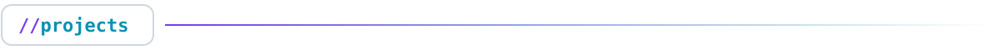
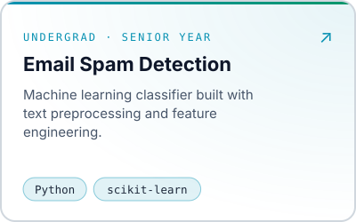
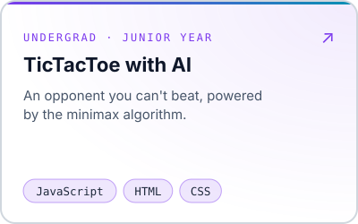
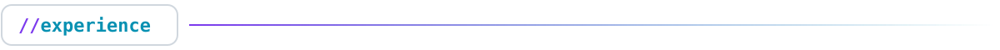

<!-- Each graphic has a dark and a light version; GitHub shows the one matching the viewer's theme. -->
<!-- Rebuild the graphics with: node scripts/gen-assets.js -->

  <a href="https://www.linkedin.com/in/ralphnehme00"><picture><source media="(prefers-color-scheme: dark)" srcset="assets/hero.svg" /></picture></a>

  <a href="https://www.linkedin.com/in/ralphnehme00"><picture><source media="(prefers-color-scheme: dark)" srcset="assets/btn-linkedin.svg" /></picture></a>
  &nbsp;
  <a href="mailto:ralphnehme00@gmail.com"><picture><source media="(prefers-color-scheme: dark)" srcset="assets/btn-email.svg" /></picture></a>

 

<a href="https://github.com/RalphNehme?tab=repositories"><picture><source media="(prefers-color-scheme: dark)" srcset="assets/h-projects.svg" /></picture></a>

  <a href="https://github.com/RalphNehme?tab=repositories"><picture><source media="(prefers-color-scheme: dark)" srcset="assets/card-ai.svg" /></picture></a>
  <a href="https://github.com/RalphNehme/Machine-Learning-for-Email-Spam-Detection"><picture><source media="(prefers-color-scheme: dark)" srcset="assets/card-spam.svg" /></picture></a>
  <a href="https://github.com/RalphNehme/TicTacToe-with-AI"><picture><source media="(prefers-color-scheme: dark)" srcset="assets/card-tictactoe.svg" /></picture></a>

<a href="https://www.linkedin.com/in/ralphnehme00"><picture><source media="(prefers-color-scheme: dark)" srcset="assets/h-experience.svg" /></picture></a>

  <a href="https://www.linkedin.com/in/ralphnehme00"><picture><source media="(prefers-color-scheme: dark)" srcset="assets/timeline.svg" /></picture></a>

<a href="https://github.com/RalphNehme?tab=repositories"><picture><source media="(prefers-color-scheme: dark)" srcset="assets/h-activity.svg" /></picture></a>

  <a href="https://github.com/RalphNehme?tab=repositories"><picture><source media="(prefers-color-scheme: dark)" srcset="https://raw.githubusercontent.com/RalphNehme/RalphNehme/output/pacman.svg" /></picture></a>

  <a href="mailto:ralphnehme00@gmail.com"><picture><source media="(prefers-color-scheme: dark)" srcset="assets/footer.svg" /></picture></a>

